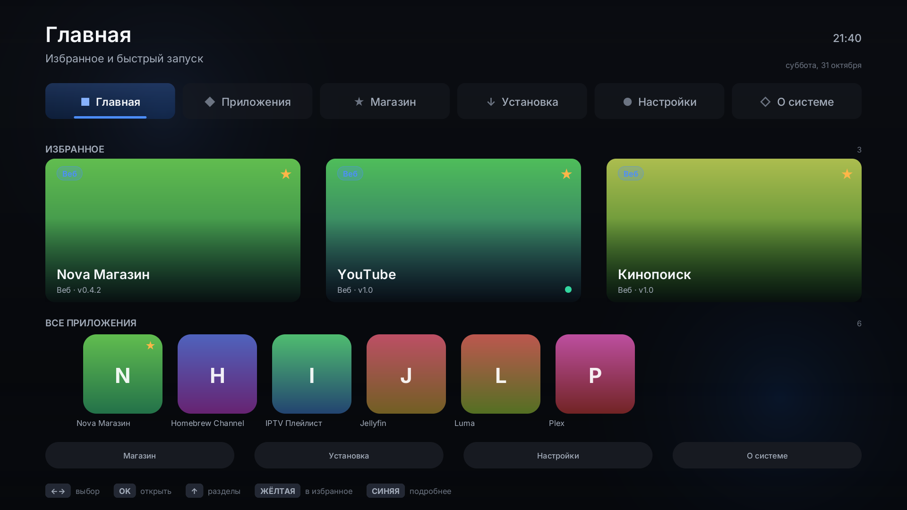
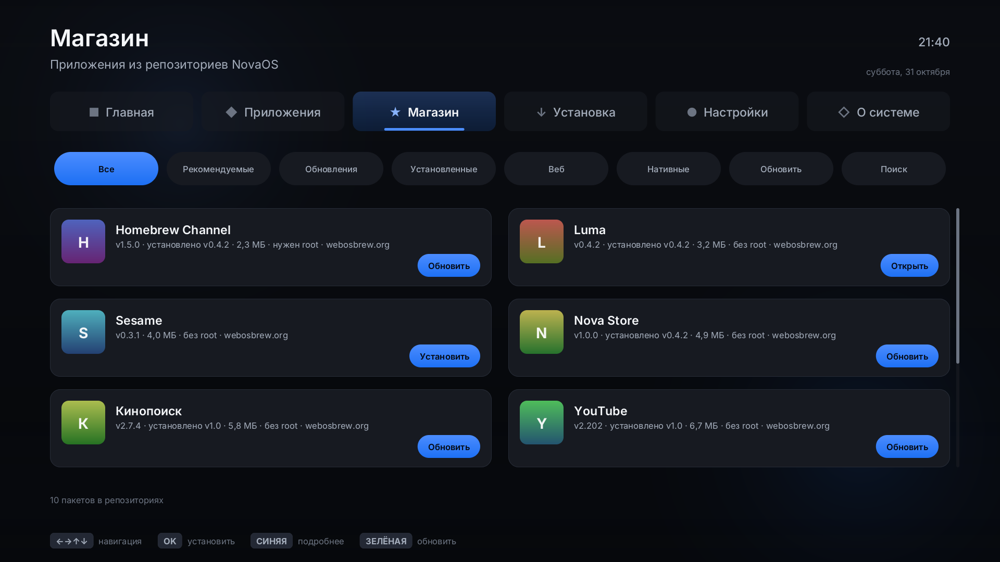
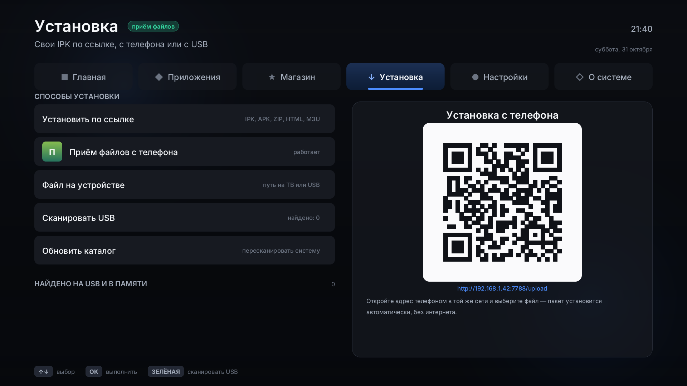
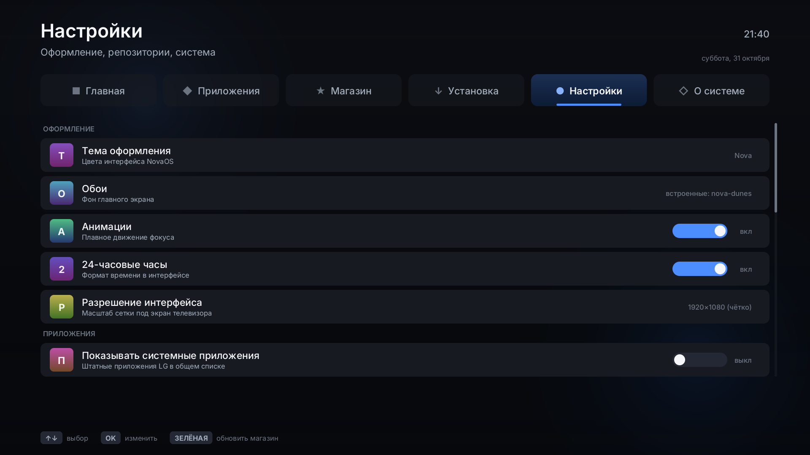

# NovaOS

Нативный лаунчер для телевизоров **LG webOS** на Rust: собственный программный
рендерер, SDL2-вывод, магазин IPK-пакетов и установка своих приложений по
ссылке, с флешки или прямо с телефона по QR-коду. Интерфейс — только русский.

Целевое устройство разработки: **LG webOS TV UM7300PLB** (2019, чип M16P,
webOS 4.x, `armv7-unknown-linux-gnueabi`, 1920×1080). Работает и на других
моделях webOS 3–6: разрешение и способ подмены Home определяются автоматически.

| Экран | Кадр |
| --- | --- |
| Главная: избранное и быстрый запуск |  |
| Магазин: пакеты из репозиториев |  |
| Установка: ссылка, USB, приём с телефона по QR |  |
| Настройки: темы, репозитории, кнопка Home |  |

Полный набор кадров — в [`docs/img`](docs/img): сетка приложений, карточки
пакета и приложения, экранная клавиатура, прогресс установки, заставка.

## Возможности

- **Шесть экранов**: Главная, Приложения, Магазин, Установка, Настройки,
  О системе — навигация стрелками пульта, цветные кнопки как горячие клавиши.
- **Магазин IPK**: несколько репозиториев (`repo.json` в формате webosbrew),
  фильтры, поиск, проверка SHA-256 и совместимости с версией webOS.
- **Установка своих пакетов**: по URL, файл на ТВ/USB, сканирование флешек и
  приёмник файлов с телефона по QR-коду (HTTP в локальной сети, без интернета).
  Понимаются не только IPK: APK, ZIP и веб-папки конвертируются в IPK на месте.
- **Подмена штатного Home** кнопкой пульта: bind-mount каталога приложения
  (webOS 3–4) или исполняемого файла (webOS 5+), хук автозагрузки в
  `/var/lib/webosbrew/init.d`, откат в один шаг.
- **Своя графика**: RGBA-холст, SDF-скругления, тени, свечение, билинейный
  ресайз иконок, кэш глифов; четыре тёмные темы с контрастом ≥ 7:1; сетка
  рассчитана на 1920×1080 и масштабируется под 720p.
- **Часы и календарь** на русском, парсер TZif для часового пояса телевизора,
  заставка после простоя.
- **Без root по умолчанию**: установка через Homebrew Channel, где он есть, и
  пошаговые инструкции (`nova --extract-ipk`), где его нет.

## Быстрый старт на компьютере

Ничего, кроме Rust и SDL2, не нужно:

```bash
cargo test --workspace                 # 152 теста, без окна
cargo run -p nova-launcher --bin nova  # окно SDL2 (стрелки, Enter, F1–F4, Q)
```

Прогон без окна с сохранением кадров и сценарием нажатий:

```bash
cargo run -p nova-launcher --bin nova -- \
    --frames 240 --every 60 --out /tmp/nova \
    --keys "Right,Ok,Down,Down,Blue,Back"
```

Снимки всех экранов для документации:

```bash
cargo run -p nova-launcher --example frames -- /tmp/nova-frames
```

## Сборка для телевизора

```bash
tools/setup-webos-sdk.sh               # тулчейн openlgtv + SDL-webOS в ~/.cache/novaos
tools/build-webos.sh                   # dist/*.ipk + repo.json + sha256sums
```

Скрипт собирает релиз под `armv7-unknown-linux-gnueabi` (Cortex-A9, soft-float),
полосит бинарник, упаковывает IPK и генерирует метаданные репозитория; в конце
пакет проверяется собственным парсером (`cargo run -p nova-core --example inspect`).

## Установка на телевизор

1. Получите root удобным способом ([rootmy.tv](https://rootmy.tv) для моделей
   2019–2021 годов или [webosbrew.org/rooting](https://www.webosbrew.org/rooting/)).
2. Установите [Homebrew Channel](https://github.com/webosbrew/webos-homebrew-channel).
3. В NovaOS откройте **Магазин → Обновить** или **Установка → Установить по
   ссылке** и укажите адрес IPK; пакет проверится по SHA-256 и встанет через
   `com.webos.appInstallService` либо через сервис Homebrew Channel.
4. В **Настройки → Кнопка Home** выберите «Подменять Home» и подтвердите:
   телевизор перезапустит оболочку уже в NovaOS. Откат — там же, одной строкой.

Без магазина: положите `dist/*.ipk` на флешку и выберите её на экране
«Установка», либо распакуйте вручную с компьютера:

```bash
nova --extract-ipk com.novaos.launcher_0.1.0_arm.ipk --dest /media/cryptofs/apps
```

Команда напечатает готовую строку для SSH-терминала телевизора.

Подробности — в [`docs/install.md`](docs/install.md), устройство пакета и
репозитория — в [`docs/packaging.md`](docs/packaging.md), архитектура кода —
в [`docs/architecture.md`](docs/architecture.md).

## Структура репозитория

```
crates/nova-core        формат IPK/APK/AXML, Luna-клиент, установка, Home, часы, QR
crates/nova-launcher    графика, темы, виджеты, состояние, экраны, бэкенды, bin nova
tv/                     appinfo.json, иконки, home.sh, хук init.d
tools/                  setup-webos-sdk.sh, build-webos.sh, package.py, repository.py
docs/                   документация и кадры интерфейса
.github/workflows       CI (тесты + кадры + сухой прогон упаковки) и Release (IPK + Pages)
```

## Лицензия

MIT. Иконки приложений принадлежат их авторам; шрифт интерфейса — подмножество
Inter (SIL Open Font License 1.1).
